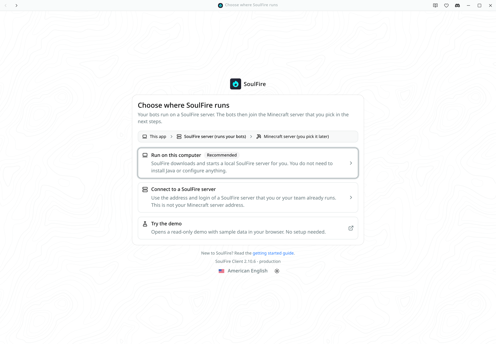
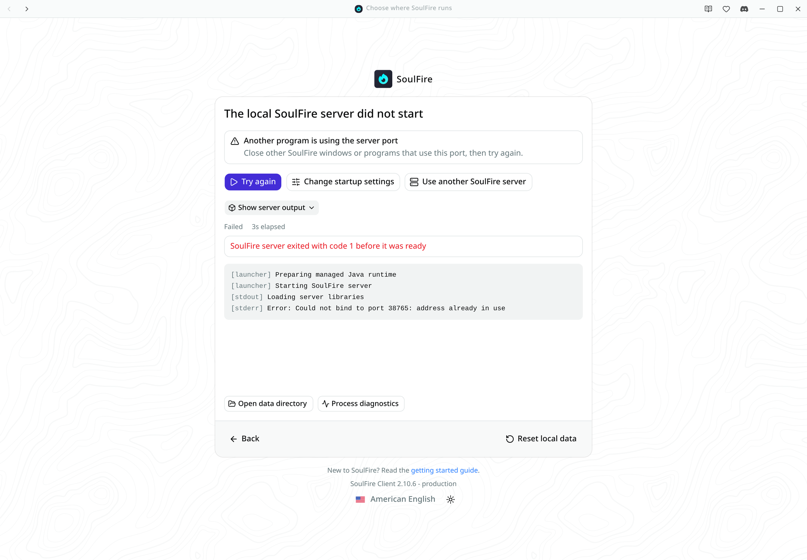
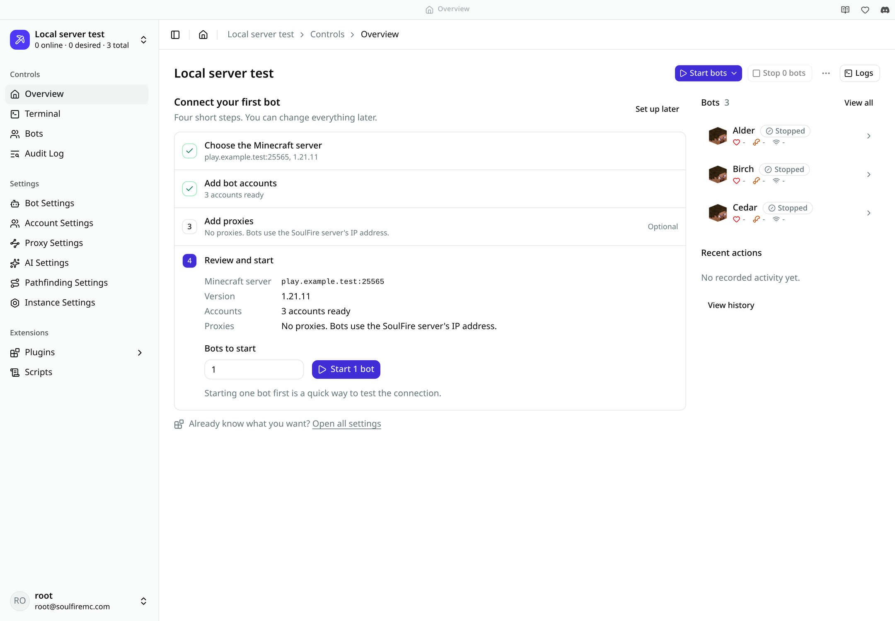
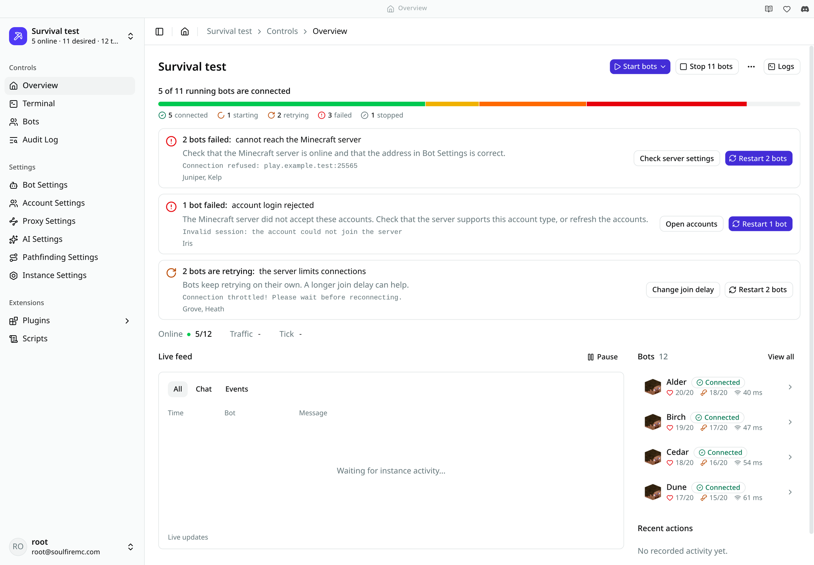
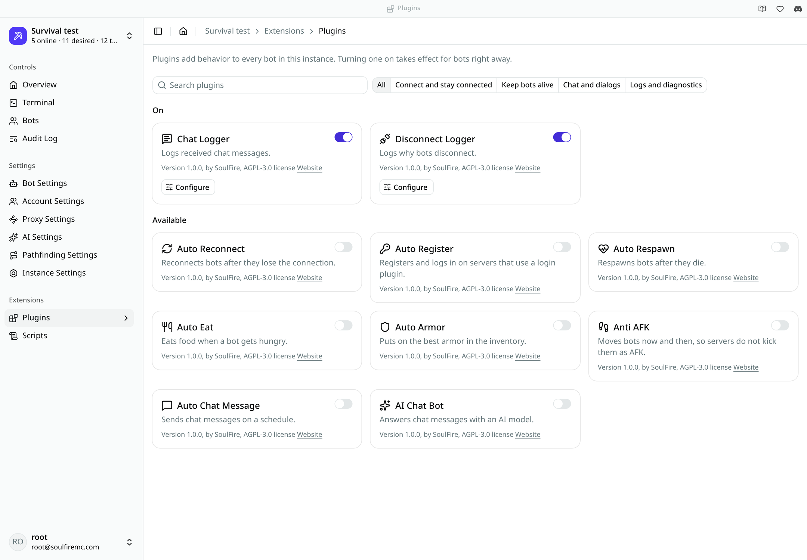
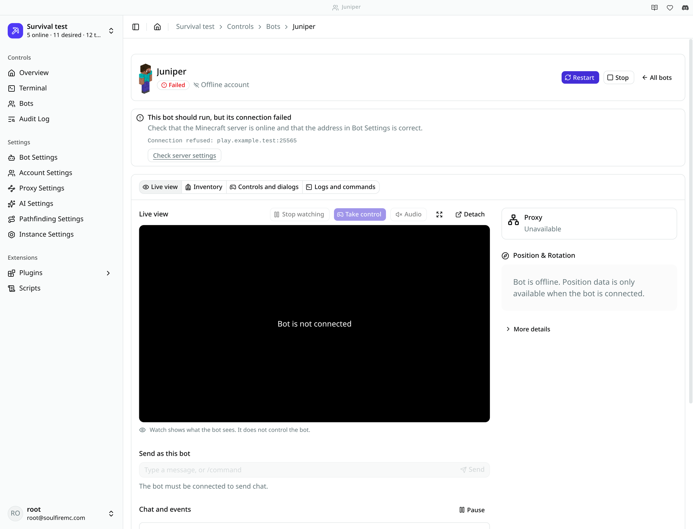
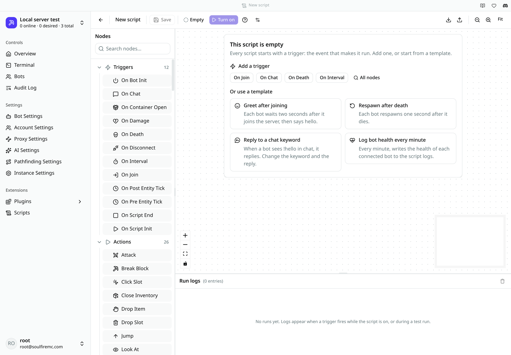

# Proposal 003: Interface system

**Status: Proposed.** This document needs a maintainer decision. It does not change the [visual identity guide](../visual-identity.md), rename a product term, or set a global standard.

## Reader and scope

This proposal is for SoulFire contributors and designers who build interface screens. It uses real screens from SoulFireClient. It covers color roles, typography and density, icons, primary actions, navigation, interface states, and guided and expert flows.

The screenshots show pending client changes on top of commit [`47356061`](https://github.com/soulfiremc-com/SoulFireClient/commit/47356061c89ddd07ae48bc9e98f225a59a4063fb). They use sample data from a local test server. They do not show a release or a measured result.

## Problem

The identity guide defines the cyan flame. It does not say how an interface uses color, density, or state. This caused specific problems in the client:

- A bot card showed **Offline** twice with different meanings: the account type and the connection state.
- A bot could show **Running** while it was not connected to the Minecraft server.
- The first screen asked for JVM arguments before it explained what a SoulFire server is.
- Most settings hid their explanations behind an information button.

## Color roles

Assign color by meaning. The theme tokens below already exist in the client. This proposal keeps their values and defines when to use them.

| Role | Token | Use it for | Do not use it for |
| --- | --- | --- | --- |
| Identity | Logo colors | The flame and places that identify SoulFire. | Buttons, links, or body text. |
| Action | `primary` | The one main action in a view, and the current step. | Decoration or status. |
| Success | `success`, `success-emphasis` | A state that the system confirmed, such as a connected bot. | A request that the system accepted but did not finish. |
| Progress and caution | `warning`, `warning-emphasis` | Starting, retrying, and problems that can clear without help. | Failures that need action. |
| Failure | `destructive` | Failed bots and actions that delete data. | Bots that the user stopped. |
| Neutral | `muted-foreground`, `border` | Stopped bots, help text, and metadata. | Text that a person must read to continue. |
| Provider | `--provider-accent` | One provider's brand inside its own selection card. | Any other screen. |

Do not make every button cyan. Measured against the page background in the client's current themes, the flame cyan `#00F3FF` has a contrast ratio of 1.38 on light and 14.34 on dark. It cannot carry text on the light theme.

| Token as text | Light | Dark |
| --- | --- | --- |
| `foreground` | 19.72 | 18.99 |
| `muted-foreground` | 4.61 | 8.08 |
| `primary` | 8.09 | 1.96 |
| `destructive` | 4.77 | 6.83 |
| `success-emphasis` | 5.36 | 10.17 |
| `warning-emphasis` | 5.03 | 11.45 |
| `info` | 3.76 | 5.24 |

These checks lead to three rules:

- Use `primary` only as a fill in the dark theme. As text, it does not pass.
- Do not use `info` for small links on the light theme. Use the current text color with an underline.
- Check `destructive` body text in place. The accessibility test measured 4.49 for `destructive` text in an alert on the light theme, so the client now colors only the icon there and keeps the text neutral.

Never use color as the only signal. Pair each state with an icon and a word.

## Typography and density

The client uses the system sans-serif stack. This proposal does not add a font family. A new typeface needs a separate proposal with licensing and rendering evidence.

| Use | Size and weight |
| --- | --- |
| Page title | 20 px, semibold. |
| Section title and setting label | 14 px, medium. |
| Body and description | 14 px, regular. |
| Metadata and status detail | 12 px, regular. |
| Identifiers, addresses, and server errors | 12 px, monospace, selectable. |

- Keep the sidebar and tables compact. People compare many rows there.
- Give guided steps and explanations more space. People read those once.
- Do not use uppercase labels or letter spacing as decoration.
- Show the server's error text exactly, and separately from the app's explanation.

## Icons

- Use Lucide icons for interface controls, as the client does now.
- Use the flame only for product identity. Do not use it as a status or action icon.
- Use real provider logos only inside provider selection, as the provider flows do.
- Use the same icon for the same state everywhere. A spinner means work in progress. It does not mean success.
- Mark decorative icons as hidden from assistive technology. Give icon-only buttons a label.
- Respect reduced motion. Show spin animation only while work is in progress.

## Primary actions and navigation

- Give each view at most one primary action. It is the most useful next step for the current state, so it can change. For a failed bot, the primary action is **Restart**. For a bot that runs well, restart is secondary.
- Label an action with its result: **Start local server**, **Take control**, **Turn on**.
- Keep the same name through the flow. A **Turn on** button gives a **Script turned on** message.
- Keep the sidebar grouped by object, and add task-based entry points inside pages. For example, plugin discovery groups plugins by task. The server still owns the plugins.
- Keep expert tools reachable from the same page. Do not remove them to simplify a first run.

## Interface states

| State | Pattern |
| --- | --- |
| Loading | Keep the page structure and labels. Use skeletons only for unknown values. |
| Progress | Name each step and the current step. Say which step can take a long time. |
| Empty | Say what is missing, why it matters, and give the next action. Offer a useful starting point, such as a template. |
| Error | Say what happened and what to do next, in app text. Then show the original error. |
| Recovery | Put the most likely fix first. Keep a way back, and show diagnostics on the same screen. |
| Success | Say what the system confirmed, and name the next useful step. |
| Permission | Say that the person lacks access, and hide or disable actions that they cannot use. |
| Demo | Say that the demo does not save changes. Do not show a saved message. |

Only suggest a specific fix when the message supports it. For an unknown error, say that the app has no specific fix and show the details. Do not guess.

Do not use a toast as the only place for a failure that blocks a task. Keep the failure on the screen with its recovery actions.

### Desired state and connection state

A bot has two separate facts: what the user asked for, and what the bot does now. Say both when they differ.

| State | Meaning | Text example |
| --- | --- | --- |
| Connected | The bot is online on the Minecraft server. | 5 of 11 running bots are connected. |
| Starting | The bot should run and is connecting. | This bot should run and is connecting to the Minecraft server. |
| Retrying | The bot should run and tries again by itself. | This bot should run and is trying to reconnect. |
| Failed | The bot should run, but needs action. | This bot should run, but its connection failed. |
| Stopped | The user did not ask this bot to run. | This bot is stopped. |

Machine values such as `BOT_RUNTIME_STATE_RUNNING` do not change. This proposal is about labels.

## Guided setup and expert flows

Guided setup helps a person reach the first result. It does not replace the expert page.

- Write to the same settings and accounts as the expert pages. Do not create a second copy of the data.
- Number steps only when the order is real.
- Mark optional steps as optional. Do not imply that proxies or paid accounts are required.
- Put free and existing options before paid options. A provider option explains when it helps, and adds no invented urgency, discount, or social proof.
- Let a person leave the guide at any time, and do not show it again to someone who already has a working setup.
- Hide rarely needed settings under **Advanced**, and keep them searchable. A new server setting must stay reachable.

## Annotated examples

### Connection choices

1. The path line shows that the SoulFire server and the Minecraft server are different things.
2. One option has a **Recommended** tag, and it has the first focus.
3. Each description says what happens. JVM and JAR options now live under **Advanced** on the next screen.

### Startup failure

1. The title states the result. The alert states the likely cause and the fix, because the output supports them.
2. **Try again** is the primary action, and two other ways forward are next to it.
3. The server output stays visible, and the data reset asks for confirmation.

### First-bot review

1. Numbered steps show real order, and checks show completed steps.
2. The proxy step is marked **Optional**, and its summary says what happens without proxies.
3. The review shows what the app will use. The default count is one bot, for a quick test.

### Instance overview

1. The headline separates the bots that should run from the bots that are connected.
2. Each failure group has one cause, the original error, the affected bots, and actions.
3. Metrics, the live feed, and bulk controls remain on the page.

### Plugin discovery

1. Task filters come from the text that the server sends. An unknown plugin goes to **Other**.
2. Enabled plugins come first, and only they show **Configure**.
3. A plain line replaces the row of metadata badges.

### Bot with a failed connection

1. One state badge replaces two badges that could disagree.
2. The notice gives the explanation, the original error, and a next step.
3. **Take control** is separate from **Watch**. A status line says who owns the keyboard and mouse.

### Empty script

1. The panel explains that a script starts with a trigger, and offers common triggers.
2. Templates are real graphs. They appear only if the server has the nodes they need.
3. **Turn on** stays disabled until the script has content. The help button explains saved, on, run, and test run.

## Compatibility

- **Instance** remains the current term. [Proposal 001](001-product-terminology.md) keeps its own status.
- Client labels that describe existing behavior, such as **Run on this computer**, do not rename a product object. Stored IDs, enum values, and API names do not change.
- Translations need review for each label change. The client changes its `en-US` source text first.

## Alternatives

- **Use cyan as the primary color.** Rejected because it fails text contrast on light surfaces and would weaken the logo's role.
- **Define a new palette first.** Deferred. The current tokens cover the roles, and a new palette needs evidence from these screens.
- **Accept these rules as a guide now.** Not possible without a maintainer decision. See [Decisions](../decisions/README.md).

## Open questions

- Should `info` change so that it passes contrast as light-theme text?
- Should `destructive` get a darker value for small text?
- Should the website adopt the same color roles?

## Sources

- [Client theme tokens at commit `47356061`](https://github.com/soulfiremc-com/SoulFireClient/blob/47356061c89ddd07ae48bc9e98f225a59a4063fb/src/App.css)
- [Bot status messages at the client's protocol pin](https://github.com/soulfiremc-com/SoulFire/blob/200cee62b3c7b4bfebff1c7c837525f6c47865a1/proto/src/main/proto/soulfire/bot.proto)
- [Screenshot sources](../assets/screenshots/README.md)
